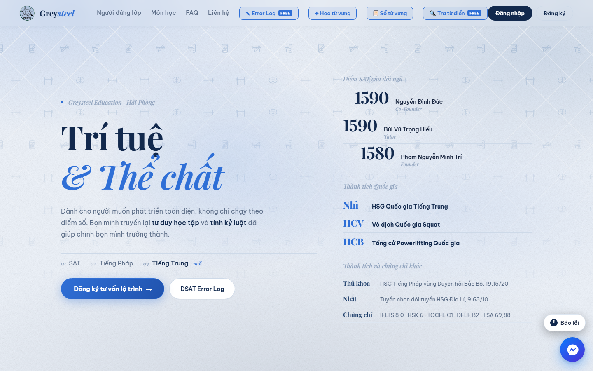
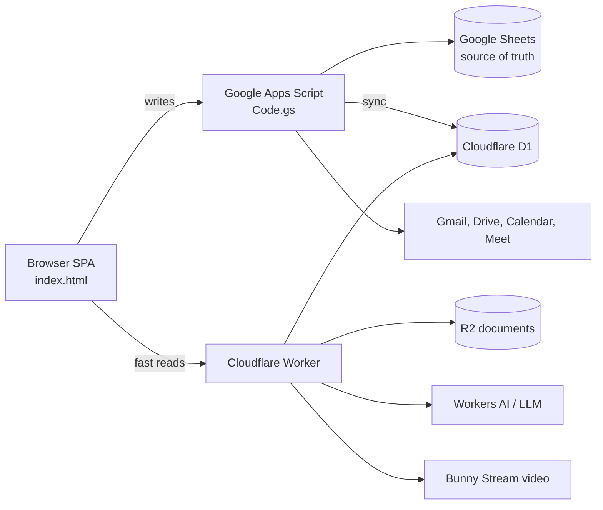
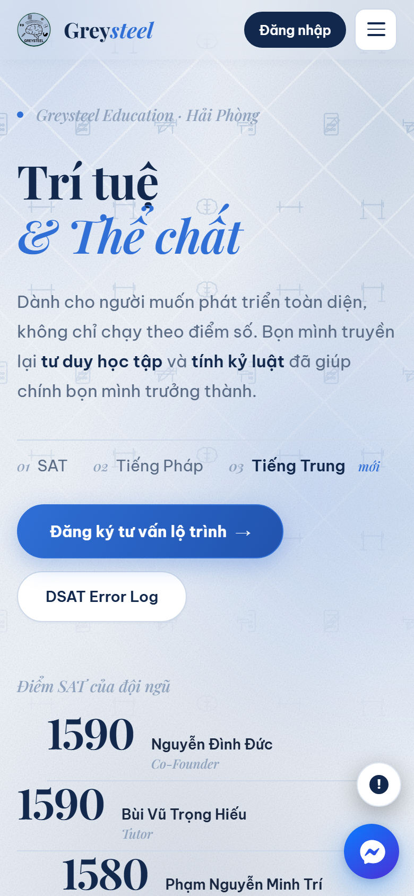

# Greysteel Education Platform

**The full operating system of a real tutoring center, built and run by one student developer.**

Live: **[thegreysteel.com](https://thegreysteel.com)** · Hai Phong, Vietnam · April 2026 to present

[English](#english) · [Tiếng Việt](#tieng-viet)

> The production source code lives in a private repository because it contains business data and configuration of a running company. This repository explains the system and shows selected modules. Reviewers who want to read the full code can ask for read access.

---

## English

### What it is

Greysteel is a tutoring center (SAT, French, Chinese) that I founded and lead as CEO. Instead of buying separate tools, I built one web platform that runs the whole business: marketing site, student sign up, recruitment, class scheduling, homework, practice tests, payroll, documents, video lessons and an AI assistant team. Students, parents, tutors, HR and admins all log in to the same site and see different tools based on their role.

### Scale

| | |
|---|---|
| Frontend (`index.html`, vanilla HTML/CSS/JS SPA) | ~26,600 lines |
| Backend (Google Apps Script) | ~16,300 lines, 200+ API actions |
| Cloudflare Worker modules | ~4,100 lines |
| Test and audit scripts | ~9,800 lines, thousands of assertions |
| Releases | v1 to v54, ~100 commits since moving to git |

### Main features

- **Accounts and roles**: student, parent, tutor, HR, admin. Email OTP sign up, salted password hashing with versioned upgrades, server side sessions with hard expiry.
- **Recruitment pipeline**: application forms for three departments with automatic scoring, manual essay grading by founders and interview scheduling.
- **Classes**: recurring weekly schedules, per session changes (reschedule, cancel, make up), reminder emails one hour before each session, change notifications.
- **Homework and practice**: assignments with file attachments, seven question types with automatic grading, and **AI import** that turns an uploaded exam file into structured questions.
- **AI essay grading**: an AI gives a provisional score using official rubrics (IELTS bands, DELF grids), then a tutor reviews it. The UI always marks the AI score as provisional.
- **Payroll and funds**: tutor pay by class model and attendance, three company funds calculated from tuition, referral commissions, and an approval queue so money changes need the founder's sign off.
- **Document library**: three level storage (subject, class, package) on Cloudflare R2 with an in browser viewer and watermarking.
- **Video lessons**: Google Meet auto recording and Bunny Stream hosting.
- **AI team**: a consulting chatbot for visitors, a marketing assistant and an AI to do list for staff.
- **Free tools for students**: DSAT Error Log, vocabulary trainer and dictionary lookup.
- **Onboarding tour, bug report box and changelog popup** so non technical users can learn the site and report problems.

### Architecture

The interesting design decision: when Google Sheets became too slow, I did not rewrite 16,000 lines of backend logic. A build script (`build-worker.js`) wraps the **same `Code.gs`** to run inside a Cloudflare Worker, replacing only the data layer (D1 instead of Sheets) and the Google services. Results are identical by construction, and a comparison script checks both servers return the same output.

### Engineering practices

- **Automated checks before every deploy** (`npm run kiemtra`): schema migration tests, 500+ backend unit tests, UI tests with Playwright.
- **Security audit tools I wrote**: [`check-quyen.js`](samples/check-quyen.js) scans every API action and fails if one does not check the caller's permission (unless it is listed as intentionally public, with a reason). [`check-xss.js`](samples/check-xss.js) fails if any HTML attribute is rendered without escaping.
- **Schema versioning** with automatic backup of the spreadsheet before migrations.
- **Staging and production separated**: Playwright tests run against a staging deploy first.

### Code samples

| File | What it shows |
|---|---|
| [`samples/chamviet.js`](samples/chamviet.js) | AI essay grading against official rubrics, with the reasoning for why AI scores stay provisional |
| [`samples/tachde.js`](samples/tachde.js) | Splitting long exam files into chunks so the model does not skip the second half |
| [`samples/check-quyen.js`](samples/check-quyen.js) | Static permission audit across all API actions |
| [`samples/check-xss.js`](samples/check-xss.js) | Static XSS check for HTML attributes |

Comments in the code are in Vietnamese because the team is Vietnamese.

### Tech stack

JavaScript (vanilla), HTML, CSS, Google Apps Script, Google Sheets / Drive / Gmail / Calendar / Meet APIs, Cloudflare Workers, D1, R2, Workers AI, Bunny Stream, Playwright, Node.js, clasp, wrangler.

---

## Tiếng Việt

### Đây là gì

Greysteel là trung tâm gia sư (SAT, tiếng Pháp, tiếng Trung) do mình sáng lập và điều hành (Founder & CEO). Thay vì dùng nhiều phần mềm rời rạc, mình tự xây một nền tảng web vận hành toàn bộ trung tâm: trang giới thiệu, đăng ký học, tuyển dụng, xếp lịch lớp, bài tập, luyện đề, tính lương, kho tài liệu, video bài giảng và đội ngũ trợ lý AI. Học viên, phụ huynh, tutor, HR và admin cùng đăng nhập một web, mỗi vai trò thấy công cụ riêng.

### Quy mô

- Giao diện: một file `index.html` khoảng 26.600 dòng, HTML/CSS/JS thuần, không framework.
- Máy chủ: Google Apps Script khoảng 16.300 dòng, hơn 200 hành động API.
- Cloudflare Worker: khoảng 4.100 dòng.
- Bộ kiểm thử và kiểm tra bảo mật: khoảng 9.800 dòng.
- Từ phiên bản 1 đến 54, khoảng 100 commit kể từ khi dùng git.

### Tính năng chính

- Tài khoản theo vai trò, đăng ký bằng mã OTP qua email, băm mật khẩu có muối, phiên đăng nhập hết hạn cứng.
- Tuyển dụng ba ban với chấm điểm tự động và lịch phỏng vấn.
- Lịch học lặp theo tuần, đổi hoặc huỷ từng buổi, dạy bù, thư nhắc trước buổi học.
- Bài tập có đính kèm, luyện tập bảy dạng câu chấm tự động, AI tách đề từ tệp tải lên.
- AI chấm thử bài viết theo khung chính thức (IELTS, DELF), người dạy duyệt lại.
- Lương tutor, ba quỹ, hoa hồng giới thiệu, mọi thay đổi về tiền phải qua founder duyệt.
- Kho tài liệu ba cấp trên Cloudflare R2, có trình xem và chữ chìm.
- Video buổi học: Google Meet tự ghi hình, lưu trên Bunny Stream.
- Đội ngũ AI: chat tư vấn cho khách, trợ lý Marketing, danh sách việc cần làm.
- Công cụ miễn phí: DSAT Error Log, học từ vựng, tra từ điển.

### Điểm kỹ thuật đáng chú ý

Khi Google Sheet chạy chậm, mình không viết lại 16.000 dòng logic mà dựng script để Cloudflare Worker chạy **chính `Code.gs`**, chỉ thay lớp dữ liệu sang D1. Kết quả giống hệt theo cấu tạo, có script đối chiếu hai máy chủ.

Trước mỗi lần deploy đều chạy bộ kiểm tra tự động, gồm cả hai công cụ bảo mật tự viết: quét quyền của mọi hành động API và quét lỗ hổng XSS.

Mã nguồn đầy đủ nằm ở kho riêng tư vì chứa dữ liệu kinh doanh. Nếu cần xem, hãy liên hệ để được cấp quyền đọc.

---

**Phạm Nguyễn Minh Trí** · Founder & CEO, Greysteel Education · [GitHub @mtri0407](https://github.com/mtri0407)
